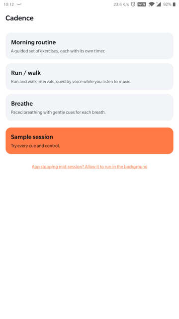
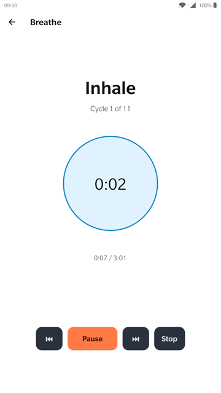

# Cadence

[](https://github.com/abhisheksao/cadence/actions/workflows/ci.yml)

Spoken-cue timers that keep working with the screen off: a morning routine, run/walk intervals, and guided breathing. Cadence is built with Expo / React Native. It targets Android first and is ready to port to iOS.

<p align="center">
  
  
  
</p>

> **Status:** early rebuild. Features are being specified and implemented one at a time. See [docs/roadmap.md](docs/roadmap.md).

## What works today

### Native foreground service & notification controls (spec 006)

[Spec 006](specs/006-native-foreground-service/spec.md) replaces `react-native-background-actions` with a dedicated Kotlin Expo Module (`modules/cadence-session`):
- **Native Android `mediaPlayback` foreground service**: Runs a headless JS task and holds a partial wake lock while the session is active.
- **Notification chronometer & action controls**: Shows a live system countdown (or count-up for untimed steps) directly in the Android notification shade and lock screen. Supports direct Pause/Resume and Skip actions carrying validated session IDs.
- **Sleep-proof clock**: Anchored to hardware monotonic `SystemClock.elapsedRealtime()`, ensuring cue scheduling and crash recovery ignore manual wall-clock or NTP adjustments mid-session.
- **Native audio focus & ducking**: Focus is managed directly via `AudioFocusRequest` (`GAIN_TRANSIENT_MAY_DUCK`, `USAGE_ASSISTANCE_NAVIGATION_GUIDANCE`, `CONTENT_TYPE_SPEECH`), ducking music cleanly without silent loop clips and falling back to haptic vibration (`vibrate(200)`) on refused phase starts during phone calls.
- **Swipe-away cleanup**: Swiping Cadence away from Recents stops the foreground service and dismisses the notification within 1 second.

### Tests & CI (spec 005)

[Spec 005](specs/005-tests-ci/spec.md) establishes automated continuous integration, releases, end-to-end testing, and spec traceability:
- **Continuous Integration (`ci.yml`)**: GitHub Actions pipeline for pull requests and pushes to `main` and `develop`, running lint, typecheck, spec verification, coverage-enforced unit tests, and assembling release APKs with artifact upload.
- **Automated Releases (`release.yml`)**: Triggered on `v*` tag pushes to build the release APK, sign with keystore secrets (or fall back to unsigned release APK), generate SHA-256 checksums (`SHA256SUMS.txt`), and publish a GitHub Release with attached assets.
- **Maestro E2E Testing**: Black-box declarative tests in `.maestro/` covering multi-mode navigation (`smoke.yaml`), live session controls (`session.yaml`), and screen-off background timing verification (`background.yaml`) with lock/unlock cycles.
- **Code Coverage & Spec Traceability**: Enforces 80% line and branch coverage across core logic (`engine`, `session`, `modes`, `storage`) and ensures spec document completeness with zero `.md` references in source code.

### Guided breathing (spec 004)

[Spec 004](specs/004-breathe/spec.md) adds guided breathing: customizable breath patterns (inhale, hold, exhale, post-hold) with presets (Box 4-4-4-4, 4-7-8 Relax, 3-4-7 Calm, Coherent), target duration in minutes, visual expanding/contracting breath pacer animation, selectable cue styles (Voice, Count, Tones), optional preparation countdown, and screen keep-awake.

### Run / walk intervals (spec 003)

[Spec 003](specs/003-run-walk/spec.md) adds interval running: customizable run and walk intervals, rounds, warm-up, and cool-down, cued by voice over music with halfway and time-left reminders, live color cues, and screen-off timing.

### Morning routine (spec 002)

[Spec 002](specs/002-morning-routine/spec.md) adds the first mode. You keep one routine of timed and untimed steps, and Cadence talks you through it: it announces each step, warns at one minute and 10 seconds left, beeps on the last 3 seconds, and waits on untimed steps until you tap **Done**. You can rename, retime, add, reorder, and delete steps (with undo) on the Edit screen. The routine is saved on the phone.

### Cue engine (spec 001)

[Spec 001](specs/001-cue-engine/spec.md) builds the engine every mode will use:

- **Cues on time with the screen off.** The engine times every cue from the wall clock, not from timer ticks, and runs inside an Android foreground service ([ADR 0001](docs/adr/0001-wall-clock-timing.md)).
- **Music keeps playing.** Beeps and speech duck other audio and never pause it ([ADR 0002](docs/adr/0002-speech-ducking-silent-clip.md)).
- **Controls.** Pause, resume, skip, back, and stop, with audio silenced right away.
- **Ongoing notification** with the session title and phase. Notification permission and the battery exemption are each asked for once.
- **Recovery.** If the OS kills the app mid-session, the next launch offers to resume where the clock says the session should be.
- **Home screen and sample session.** The modes are listed on the home screen; those not built yet are marked coming soon. A sample session uses every cue type, and a 60-minute soak tests timing.
- **Timing log.** Each cue writes one log line. `npm run timing-report` checks the log against the accuracy targets.

## Spec-driven development

This project uses [GitHub Spec Kit](https://github.com/github/spec-kit). Each feature starts as a spec and goes through these steps before any code is written:

```
specify → clarify → plan → tasks → implement
```

- Project principles: [`.specify/memory/constitution.md`](.specify/memory/constitution.md)
- Feature specs, plans, and tasks: [`specs/`](specs/)
- Roadmap: [docs/roadmap.md](docs/roadmap.md)

## Build locally

Requirements: Node 22+, JDK 17+, and an Android SDK with `ANDROID_HOME` set. No EAS or cloud services are needed.

```bash
npm install
npx expo run:android      # dev build on a connected device or emulator
```

Release APK (also local):

```bash
npx expo prebuild -p android
(cd android && ./gradlew assembleRelease)
```

`android/` and `ios/` are generated by `expo prebuild` and git-ignored. Change native settings in `app.json` or config plugins.

## Tests

```bash
npm run check             # lint + tsc --noEmit + check:specs + jest
npm run test:coverage     # jest with coverage collection & 80% core thresholds
npm run check:specs       # spec completeness, link health, and src/ md audit
npm run test:e2e          # Maestro end-to-end tests (.maestro/)
```

### Unit & Integration Tests

The engine and session controller run against a fake clock, so timing behaviour, such as late ticks, deep sleep, and clock changes, is tested without a device. Coverage thresholds require at least 80% line and branch coverage across core packages (`engine/`, `session/`, `modes/`, `storage/`).

To capture and analyse the timing log on a physical phone:

```bash
adb logcat -s ReactNativeJS:I | grep CADENCE_CUE > cues.log
npm run timing-report cues.log
```

See [specs/001-cue-engine/quickstart.md](specs/001-cue-engine/quickstart.md) for detailed timing checks.

### End-to-End Tests (Maestro)

Cadence includes declarative black-box E2E flows in `.maestro/`:
- `.maestro/smoke.yaml`: Launches app and navigates through all modes (Morning Routine, Run / walk, Breathe).
- `.maestro/session.yaml`: Starts a session, verifies the live pacer and clock, and exercises pause, resume, and stop controls.
- `.maestro/background.yaml`: Starts a session, locks the device screen (`lockDevice`), waits 6 seconds, unlocks (`unlockDevice`), and verifies session continuity.

Prerequisites:
- [Maestro CLI](https://maestro.mobile.dev/getting-started/installing-maestro): `curl -FsSL "https://get.maestro.mobile.dev" | bash`
- An Android device or emulator visible in `adb devices`.

Run all flows:
```bash
npm run test:e2e
```

## Releases

Releases are published automatically via GitHub Actions whenever a version tag (`v*`) is pushed:
1. Assembles release APK via `expo prebuild -p android` and Gradle `assembleRelease`.
2. Signs the APK if repository keystore secrets are configured (or outputs standard release APK).
3. Computes SHA-256 hash and produces `SHA256SUMS.txt`.
4. Creates a GitHub Release with `cadence-release.apk` and `SHA256SUMS.txt` attached.

## License

[Apache License 2.0](LICENSE). Copyright 2026 Abhishek Sao.
